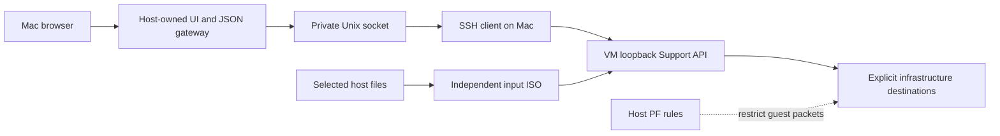

# VM host boundary

**Deployment decision:** Support connects to an independently managed VM. The identified provider is **vagrant-tart 1.0.0**. See [existing VM installation and validation](existing-vm.md). The app-owned VM controller was removed; native Tart network validation remains required and activation remains gated.

Implemented 2026-11-08: a separate host UI/data gateway, private-socket SSH transport, a host PF policy generator and verifier, a Vagrant configuration guard, and independent input snapshots/images. **Not yet deployed or certified on the user's Mac. Native VM activation is gated in code.** The current Linux/local service remains unchanged. Neither this code nor a successful `check-network` result proves that an unknown native Vagrant provider's packets traverse PF.

## Trust and data flow

The guest supplies data only. It does not supply HTML, JavaScript, CSS, executable downloads, proxy targets, browser headers or updates. The host bundle must be built/distributed through the trusted host release path and stored outside every guest share. Build it with `npm run build`; `host-dist/` contains compiled, dependency-free Node code plus a separately hashed copy of the UI. Current development tooling requires Node 24 on the Mac. It is not yet the final drag-install package.

The gateway uses a fixed Unix socket in a private host directory. There is **no raw TCP tunnel port** for the browser to open. SSH uses a dedicated host key file, pinned server keys, no config execution, agent, X11, shell, multiplexing, reverse forward or network-device tunnel. No SSH agent socket is inherited, even for authentication. The guest account's additional restrictions are in `deployment/vagrant/support-forward.sshd.conf` (adjust its fixed Support port if necessary).

The browser receives only the captured host assets and bounded JSON. The host reconstructs its single session cookie and never relays other guest headers, redirect destinations, service-worker scope or CORS/CSP policy. HTTP CONNECT and upgrades are rejected. Four concurrent upstream requests, 256 KiB request bodies, 4 MiB responses and absolute response deadlines bound resource use. A fixed host CSP disallows other connection origins, frames, workers and embedded objects. All rendered links go through the host boundary component: guest-provided URLs are inert text, including right-click/context-menu navigation. Host-created Markdown/settings downloads still work. Existing local mode keeps its normal links.

**Temporary isolated-mode limitation:** opening external service links and starting a new subscription OAuth sign-in in this browser are disabled. Existing accounts and API keys remain usable. A separate host-owned sign-in flow must be implemented before allowing those navigations; the guest cannot choose the Mac's navigation destination. Local-mode sign-in is unchanged.

The native companion's VM mode verifies a fresh HMAC challenge using a host-only key before pairing, polling or opening the browser. It no longer creates a raw browser-facing SSH tunnel. The key is not a service credential and never enters the VM. Local-service mode remains available. A missing gateway produces an error rather than falling back to a direct tunnel.

## Native Vagrant provider: required integration checks

The user uses Vagrant with native Apple virtualization. The provider is vagrant-tart 1.0.0; the installed Tart/Softnet versions, actual runtime arguments and host network enforcement still require inspection. Apple NAT alone is not a host-access boundary. PF is an administrator facility, not a supported Apple application API; this implementation is an **advanced, reviewed bridge profile**, not automatic firewall provisioning for arbitrary native NAT.

Run `node host-dist/host/main.js inspect-vagrant /host/vagrant/project` on the Mac to report the exact provider and VM state. This uses the existing, host-trusted Vagrantfile and never starts or provisions a VM. The output identifies the missing provider integration; it is not an attestation.

Before enabling AI workloads in this profile, the provider-specific adapter and an administrator must verify on the Mac:

1. The VM has exactly the intended dedicated, host-filterable interface. No additional NAT, bridged LAN, user-mode networking, host proxy, forwarded ports or provider-specific path bypasses it. Do not guess `bridge100` from the example. Inspect `vagrant status`, `vagrant plugin list`, final provider configuration, `ifconfig -a`, and actual packet capture/counters.
2. IPv4 is static. No host DHCP/DNS service exception is granted. IPv6 is denied on this interface. DNS, if needed, must use an explicitly approved remote resolver (add both required protocols/ports); host resolvers are blocked.
3. A deny/allow probe must demonstrably hit this interface and the installed PF counters. A synthetic guest "passed" message is not proof. If native NAT traffic bypasses these rules, **do not use this profile**; that provider needs a supported isolated network adapter or the future host-owned virtual network broker.
4. The VM is powered off during policy/share changes. Remove pre-existing guest PF states before boot; otherwise older states can bypass new rules. Never flush unrelated host states or disable PF globally. Ensure there are no prior IPv6 states either.
5. The reviewed rule file is `/etc/pf.anchors/support_vm`, owned by root and not group/world writable. `anchor "support_vm" quick` must be the first filter rule, after any PF translation/normalization declarations. Persist its `load anchor` in the host's existing PF configuration and load it before the VM starts at boot. Preserve other host rules. No unreviewed `set skip` exemptions are accepted by the verifier.

The policy blocks guest-source spoofing, all IPv6, all Mac interface addresses (`self`), loopback/link-local/multicast and every unlisted destination. Egress grants use individual IPv4 addresses, protocol and port, never a broad CIDR or a guest-controlled hostname. Infrastructure IPs inside the company network may be explicitly listed; **Mac addresses are rejected even if listed**. Return traffic uses interface-bound state. Host-initiated SSH has a separate stateful grant. Host VPN/routing changes or provider upgrades require the same reachability tests again. An allowed remote endpoint must not itself act as a proxy back to the Mac.

`node host-dist/host/main.js network-rules /absolute/host-profile.json` prints the rules without installing them. The example profile is intentionally unusable until replaced with real, reviewed values and private mode-0600 files. An administrator installs/reloads PF independently; this app exposes no privileged mutation endpoint and never changes `/etc/pf.conf` automatically. `pf-inspection.sudoers.example` limits the normal Mac user to five exact, read-only PF inspection commands. The gateway must never run as root.

`node host-dist/host/main.js check-network /absolute/host-profile.json` validates the root-owned rule file, active PF status, first anchor, loaded rules against the system's own PF parser output, and interface presence. Missing permissions or ambiguous output fails closed. This command is not a provider/topology attestation.

**`serve` is intentionally disabled by `requireVerifiedNativeProvider()` before any tunnel or listener is opened.** There is no `--unsafe`, environment override, checkbox or self-attested profile to bypass this gate. A provider adapter must inspect and control the actual network, devices, folders and lifecycle on macOS before activation can be implemented. Generic PF rule matching is insufficient.

The gateway supervisor implementation is ready behind this gate: it verifies the policy every five seconds and closes API/UI access and SSH on failure. Permanent PF rules are never removed when it exits. The current generic supervisor does not power off an externally managed Vagrant VM; lifecycle enforcement is another required adapter responsibility. Until that work is verified, the gateway's HTTP/data behavior is exercised only in isolated test fixtures, while `network-rules`, `check-network`, `snapshot`, `input-image` and `inspect-vagrant` are usable development tools. The current local service remains available.

## No live Mac folders

There is no `/Users`, home, `.ssh`, `.kube`, host application, control socket or writable repository mount. Disable Vagrant's default `/vagrant` as well as the existing `~/claude_access → /workspace` share. Merely adding `ro` inside Linux is insufficient; a compromised guest can change its own mounts.

Load `deployment/vagrant/support-boundary.rb` from a host-owned Vagrantfile and call `SupportBoundary.configure(config)` inside `Vagrant.configure`. It disables the default share and agent forwarding, then validates the final merged Vagrant configuration: all other enabled synced folders, public networks and forwarded ports are rejected. Existing provider-specific disks/shares/clipboard integrations must also be disabled in the native provider; the Vagrant generic validator cannot discover undocumented provider extensions. This guard does not start, destroy or replace any VM.

Prefer cloning infrastructure repositories directly into guest storage. For selected existing inputs:

1. Stop the VM and remove its old shares before exporting, so the guest cannot race changes to the source tree.
2. Create a private host output directory (`0700`) outside the source, application and credential folders.
3. Run `node host-dist/host/main.js snapshot /selected/workspace /private/output/new-snapshot`, or on the Mac `input-image /selected/workspace /private/output/inputs.iso`.
4. The exporter copies regular files into independent storage, rejects symlinks/hard links/sockets/devices, enforces file/size/depth limits, strips executable/write permission, excludes common credential/configuration directories, and records hashes. It does not execute Git hooks, filters or repository scripts. Exclusions are not a secret scanner: review selected input contents before export.
5. `input-image` uses the Mac's fixed `hdiutil` command to produce ISO9660 media. Attach that independent image as **read-only** in the actual provider. Do not attach the source folder or allow guest access to the output directory. There is no guest-to-host sync/copy-back action. Work on a guest-local copy; review resulting GitLab diffs through the existing approval flow.

The input image is generated before guest access, never updated in place, and not a live VirtioFS/NFS/SMB share. New input requires a new host-initiated snapshot. Vagrant/SSH provisioner credentials and host policy live outside anything exported. The gateway and its package are never loaded from a guest-writable checkout.

## Migration and validation

The current local backend, data, Vault and approval rules are not migrated automatically. Its localhost port can remain 4173 in the VM; the Mac gateway also uses 4173 on the Mac, connected only through the private SSH socket. Stop old Mac `ssh -L ...4173...` tunnels first. In container mode publish Support only on **VM loopback**, not every interface. Keep existing approved jobs paused during boundary migration; do not introduce duplicate schedulers.

Automated tests exercise hostile guest responses through an actual Unix socket, host assets and header authority, cookie/CSRF forwarding, blocked navigation, resource/time limits, PF decision validation, effective OpenSSH arguments and filesystem escape attempts. Full Mac acceptance must additionally cover active IPv4/IPv6 host probes (including SSH, SMB, gateway, localhost aliases and VM hostnames), DNS changes, interface/state changes, provider bypasses, shared-folder writes, occupied ports, browser navigation/context-menu attacks, companion pairing, and recovery without an insecure fallback.

References: [Apple Packet Filter guidance](https://developer.apple.com/documentation/technotes/tn3165-packet-filter-is-not-api), [Apple NAT attachment](https://developer.apple.com/documentation/virtualization/vznatnetworkdeviceattachment), [Vagrant default shared folder](https://developer.hashicorp.com/vagrant/docs/synced-folders), [Vagrant disabling synced folders](https://developer.hashicorp.com/vagrant/docs/synced-folders/basic_usage), [Apple shared directories](https://developer.apple.com/documentation/virtualization/shared-directories).

Validation for this slice: build passed; the full 273-test suite passed, followed by all 23 focused security/integration tests after adding the explicit provider-activation gate. A separate CLI regression confirmed that a profile claiming `verified: true` still cannot activate the unverified native provider. Browser checks through an isolated Unix-socket fixture verified unlock with Enter, settings navigation, inert external links and session/filter persistence after reload. The fixture simulated network health; no Mac firewall, native Vagrant provider or AppKit enforcement was claimed.
